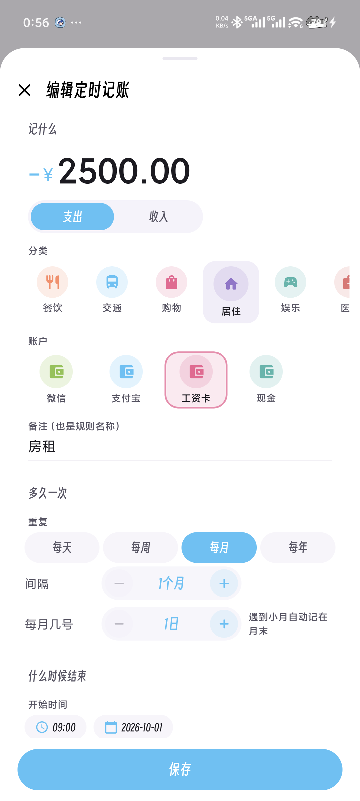

# 阿福记账 (Afu Ledger)

本地优先、离线运行、可换肤的 Android 记账应用。支持微信 / 支付宝账单识别、定时记账、预算预警与收支报表。

<p>
  
  
  
  
</p>

- 完全离线：不申请 `INTERNET` 权限，数据存本机 Room 数据库
- 数据可迁移：JSON 备份导出与导入
- 自动记账：无障碍节点识别，节点缺失时用截图 OCR 兜底
- 预算：首页显示剩余额度，按使用率变色提醒

## 目录

- [功能](#功能)
- [截图](#截图)
- [数据与备份](#数据与备份)
- [技术栈](#技术栈)
- [架构](#架构)
- [构建与测试](#构建与测试)
- [自动记账](#自动记账)
- [性能](#性能)
- [已知边界](#已知边界)
- [路线图](#路线图)
- [许可证](#许可证)

## 功能

### 记账

- 支出 / 收入、分类、账户、备注、日期；底部面板自带数字键盘
- 键盘含数字与退格，退格单击删一位、长按清空；日期与备注各一个入口；❌ 或下滑关闭
- 金额上限 9 位整数 + 2 位小数，记账、资产、预算、定时记账一致
- 明细页：月度结余、可切换月份的月历筛选、按日分组
- 分类管理：14 个内置分类，支持新增、重命名、换图标与颜色、删除；被引用的分类不可删除
- 32 个分类图标，统一圆角风格

### 自动记账

- 识别支付成功页与账单详情页，提取金额、商户、交易单号
- 确认卡片标注来源（支付结果页会标注「支付页」）
- 微信页面不暴露无障碍节点，改用截图 + 本机离线 OCR
- 交易单号指纹去重：同一笔忽略后 7 天内不再提示，重启后仍生效
- 同一笔付款跨页面只确认一次，后到的信息合并进已打开的卡片
- 仅需无障碍权限，不申请网络、悬浮窗、通知读取、相册或短信权限；截图只存在内存
- 可选 Shizuku 自动恢复被系统移除的无障碍授权

### 定时记账

- 固定收支到点自动入账，单条也可改为确认后入账
- 支持每天、每周指定星期、每月指定日、每年、每 N 个周期；某月没有该日时按月末计算
- 结束条件三选一：永不结束、指定日期、执行满 N 期
- 编辑器按「记什么 / 多久一次 / 什么时候结束 / 到期怎么做」四个分区组织
- 错过期次会按计划时刻补记，同一期次不重复入账

### 预算

- 总预算（统计全部支出）与分类预算（绑定 1~N 个分类）
- 周期：每月（起始日可设 1–31）、每周、每年、自定义起止区间
- 首页预算卡片显示剩余额度与进度条，按使用率分档：`< 60%` 正常、`60–80%` 提示、`≥ 阈值` 预警、`≥ 100%` 超支
- 跨周期自动切换
- 编辑面板与记账面板同款，金额用系统数字键盘输入，保存后立即生效
- 预算不做结转，额度只约束当期

### 资产与报表

- 账户类型：现金、银行卡、微信、支付宝、信用卡；余额 = 初始余额 + 收入 − 支出，实时计算
- 账户支持长按拖动排序，顺序持久化，记账与定时记账的账户选择同步
- 金额完整显示（千分位 + 两位小数），大额按字号与折行自适应
- 点净资产可切换隐私遮罩，状态持久化
- 收支报表：月度结余与上月对照、每日支出趋势、分类占比与排行、单笔支出排行；图表由 Canvas 绘制

### 外观

- 两套主题风格：「默认」与「大肥鱼」；后者为蓝白鲸鱼娘主题，含描边卡片、虚线分隔、贴纸化底部导航与中央按钮
- 8 套主题色，与风格正交，选择后即时生效并持久化
- 深色模式：跟随系统 / 浅色 / 深色，卡片透明度与背景压暗自动适配
- 自定义背景图：相册选择、可见度滑块、模糊与暗色遮罩；冷启动首帧使用占位缩略图淡入
- 转场动效：标签切换与二级页面滑入；记账、预算、定时记账三个面板共用同一进场与关闭动效；按键有按压缩放与轻触反馈；系统关闭动画时自动退化
- 标题字体：得意黑 Smiley Sans（SIL OFL 1.1，许可随包附带）

## 截图

> 以下截图使用演示账本（虚构账户、交易与预算）。

| 首页（含预算卡片） | 预算管理 | 新建预算 |
|---|---|---|
|  |  |  |

| 记账面板 | 明细（月历 + 分组） | 收支报表 |
|---|---|---|
|  |  |  |

| 资产 | 定时记账 | 编辑定时记账 |
|---|---|---|
|  |  |  |

| 设置 | 外观与主题 |
|---|---|
|  |  |

## 数据与备份

### 升级

- Room `AutoMigration` + instrumentation 迁移测试，覆盖「上一版本 → 当前版本」
- 仓库提交每个版本的 schema JSON（`app/schemas/`），迁移错误在测试阶段暴露
- release 包使用固定 keystore 签名，系统更新与 `adb install -r` 均为覆盖安装
- 不使用 `fallbackToDestructiveMigration`，迁移失败时报错而非清空数据

### 导出 / 导入

- 设置 → 数据管理 → 导出备份：生成 UTF-8 JSON，保存到系统文件选择器指定的位置，无需存储权限
- 备份包含账户、分类、交易、定时规则、预算，以及格式版本与应用版本
- 导入先校验格式与版本，再在一个事务里「清空 + 写入」，失败整体回滚
- 导出按 500 行分批流式写入，内存占用不随账单数量增长
- 备份格式见 `BackupModels.kt`；v1（无预算）备份仍可导入

### 清空数据

设置 → 数据管理 → 清空全部数据（二次确认）。只清账本数据，主题与自动记账开关保留。

## 技术栈

| 维度 | 选择 |
|---|---|
| 语言 | Kotlin 2.3 |
| UI | Jetpack Compose + Material 3 |
| 架构 | MVVM：Screen → ViewModel → Repository → Room DAO |
| 数据库 | Room + KSP（版本化迁移 + schema 导出） |
| 配置存储 | DataStore Preferences |
| 图片加载 | Coil 3（按屏幕尺寸解码背景图） |
| 离线 OCR | ML Kit 中文文字识别（bundled，整页一次推理） |
| 序列化 | kotlinx.serialization（备份文件） |
| 构建 | AGP 9.4 / Gradle 9.8 / compileSdk 37 / minSdk 26 |

## 架构

```
com.afu.ledger
├── auto/                无障碍自动记账（服务、页面规则、金额解析、去重、悬浮窗、OCR）
├── data/
│   ├── local/           Room Entity / DAO / Database（v3：含 budgets）
│   ├── repository/      聚合 DAO，向 UI 暴露 Flow
│   ├── backup/          备份 DTO、导出 / 导入 / 清空
│   ├── prefs/           DataStore（主题、深色模式、背景图与占位缩略图）
│   └── AppContainer.kt  手写依赖容器
├── domain/
│   ├── model/           领域模型（Money、Account、Category、Transaction、Budget）
│   ├── budget/          预算周期计算与预警分档
│   └── schedule/        定时记账的期次计算
├── schedule/            闹钟、开机恢复、补记
├── ui/
│   ├── theme/           颜色、形状、字体、间距 token、两套风格
│   ├── component/       通用组件（卡片、胶囊按钮、金额文本、预算卡片）
│   ├── home/            首页（今日 + 预算）
│   ├── record/          记账面板
│   ├── history/         明细与月历
│   ├── report/          收支报表
│   ├── assets/          资产账户
│   ├── budget/          预算管理
│   ├── schedule/        定时记账
│   ├── category/        分类管理
│   └── settings/        设置（含数据管理）
└── util/                金额与日期格式化
```

约定：一个文件一个主要类型，单文件不超过 300 行，UI 不直接访问 DAO，金额一律用「分」存 `Long`。

## 构建与测试

需要 JDK 17+、Android SDK（platform 37、build-tools 37）。

```bash
export ANDROID_HOME=/path/to/Android/Sdk
export GRADLE_USER_HOME=/path/to/gradle-home   # 避免污染系统盘

./gradlew assembleDebug
adb install -r app/build/outputs/apk/debug/app-debug.apk
```

### 发布签名

```bash
cp keystore.properties.example keystore.properties   # 填入 keystore 路径与密码
./gradlew assembleRelease
```

`keystore.properties` 与 `*.jks` 已被 `.gitignore` 排除。release 包默认回退 debug 签名，正式发布需配置固定 keystore，否则后续升级会安装失败。

### 测试

```bash
./gradlew test                        # JVM 单元测试
./gradlew connectedDebugAndroidTest   # 真机测试（余额聚合、数据库迁移、备份往返）
```

迁移测试需要真机或模拟器，会读取 `app/schemas/` 下已导出的 schema。

## 自动记账

### 文本来源

| 来源 | 使用条件 | 耗时 |
|---|---|---|
| 无障碍节点文本 | 页面节点行数与字符数达标 | 数十毫秒 |
| 截图 + 离线 OCR | 节点为空或不完整（微信全部页面、支付宝 H5 账单页） | 283–399ms（30 行账单页） |

- 节点优先，OCR 兜底：节点被判为「丰富」时先采信；未命中且 OCR 可用时再试一次
- 整页一次推理：不做「先检测文本框、再逐行识别」的两阶段，30 行页面耗时从 1450–2204ms 降至 283–399ms
- 金额只排除不挑选：余额、状态栏网速等按上下文排除；仍有多个不同金额时放弃识别
- 主界面不触发：「扫一扫 / 收付款 / 卡包」等入口出现时不识别
- 账单页需强证据：「交易单号 / 商户单号 / 收单机构」命中 ≥ 2，或标题为「账单详情」
- OCR 纠错仅限数字上下文：`O→0`、`l→1`、`S→5`、`B→8`、紧邻数字的 `Y→¥`；纠正后仍不合规则放弃

### 去重

- 交易单号做指纹；无单号时退化为「包名 + 金额 + 商户 + 日期」
- 同一账单忽略后 7 天内不再提示，重启后仍生效
- 卡片在切走应用、翻页、点忽略或 60 秒超时后自动收起

### 截图节流

- 仅在微信前台且无障碍文本不可用时截图
- 页面稳定判定：用户点击或切页后 180ms，其余内容变化 600ms
- 内容变化至少间隔 8 秒，用户点击或切页至少间隔 1.5 秒
- 连续识别失败时自动退避，最长 60 秒；用户主动点击时仍按切页间隔放行

> 微信在同一 Activity 内翻页只发内容变化事件，因此点击也按切页处理，否则连续快速翻页会被节流拦掉。

### 后台存活

无障碍权限本身不会过期，只在应用被 force-stop 后丢失；在这类 ROM 上，从最近任务划掉卡片即等于 force-stop。

- 前台服务 + 低优先级常驻通知，抬升进程优先级
- 悬浮窗预热放到 `Handler.post`，避免 `wait for adding window timeout`
- 设置页「允许后台运行」一键申请电池优化豁免
- 进程存活时监听权限撤销并发出告警
- 可选 Shizuku：每 15 分钟巡检并写回启用列表

force-stop 之后，纯应用层手段无法恢复权限，必须重新授权。

### 调试

debug 构建内置模拟页面：

```bash
adb shell am start -n com.afu.ledger/com.afu.ledger.debug.DemoPaymentActivity \
  --es scenario WECHAT_SUCCESS   # 另有 ALIPAY_BILL / AMBIGUOUS / FUTURE / REFUND / NON_PAYMENT
```

`WECHAT_OCR_FULL` / `OCR_NOISE_O` / `OCR_NOISE_BAD` / `OCR_LOW_CONTRAST` / `OCR_CHAT` 用 Canvas 自绘、不产生无障碍节点，用于验证截图 OCR 通道。

## 性能

release 构建实测（Android 16，1440×3200）：

| 场景 | 结果 |
|---|---|
| 冷启动到首帧（`am start -W` TotalTime） | 205–334ms |
| 明细页快速滑动（300 笔 + 照片背景） | Janky 0%，50 分位 11ms / 90 分位 15ms / 99 分位 28ms |
| 设置页快速滑动 | Janky 0%，90 分位 9ms |
| 手势返回 / 标签切换 | 单一 `AfuMotion` 曲线，系统关闭动画时瞬时切换 |
| release APK | 约 19 MB（含 ML Kit 中文 OCR 模型） |

- 背景图按屏幕像素解码，首帧使用 240px 占位缩略图
- 设置页的定时刷新订阅放在 `LazyColumn` 之外
- 交互动效统一由 `AfuMotion` 管理

## 已知边界

- 自动记账只处理支出；银行到账、红包、退款、先用后付不在范围内
- 只适配微信与支付宝的账单详情页与支付结果页；在美团、淘宝等 App 内付款不会触发
- 页面同时出现两个不同金额时放弃识别
- 只保留 arm64-v8a ABI
- 预算不做结转，不支持账户维度限制
- 应用不上架商店，仅通过 GitHub Release 分发 APK

## 路线图

- [x] 手动记账 + 资产 + 换肤
- [x] 无障碍自动记账（微信 / 支付宝）
- [x] 截图 OCR 记账
- [x] 定时 / 周期记账
- [x] 收支报表与日历
- [x] 预算管理（总预算 / 分类预算 / 自定义周期 / 预警）
- [x] 本地备份导出与导入、数据库迁移测试
- [ ] 通知监听通道（银行到账、红包、先用后付）
- [ ] 多币种

## 许可证

本项目采用 **[PolyForm Noncommercial 1.0.0](LICENSE)**：

- 可以：个人学习、研究、自用、修改、再分发（须保留许可与版权声明）
- 不可以：任何商业用途（含在公司或经营场景中使用）
- 版权归作者所有；作者本人不受该许可限制，保留自行商用与另行授权的权利

需要商用授权请开 issue 联系。

第三方组件许可见 [THIRD-PARTY-NOTICES.md](THIRD-PARTY-NOTICES.md)。
