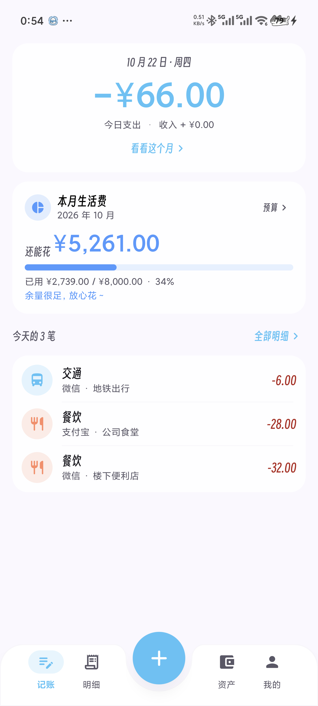
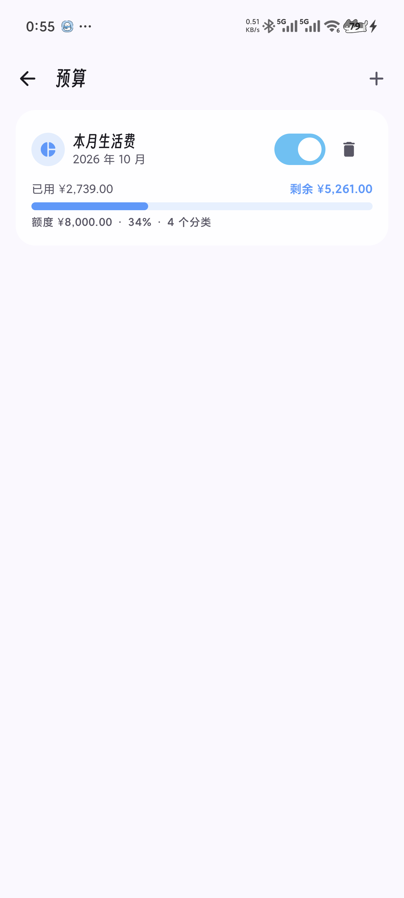
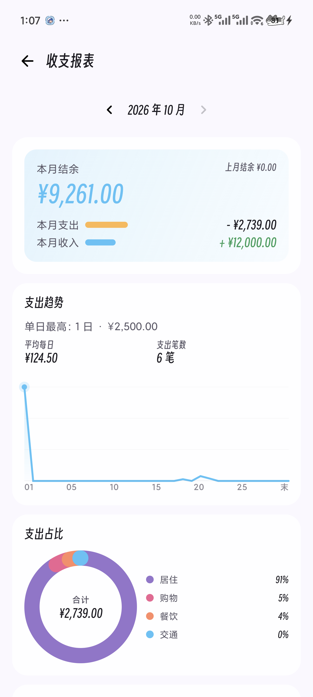
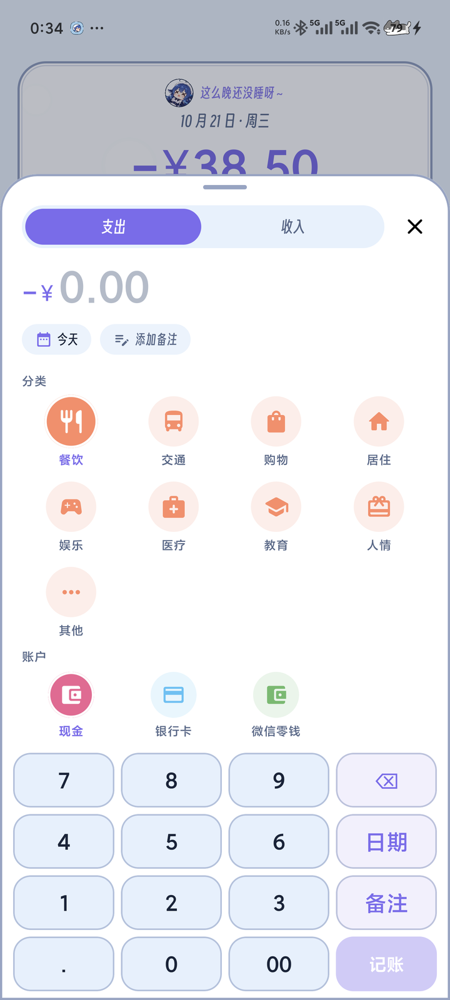
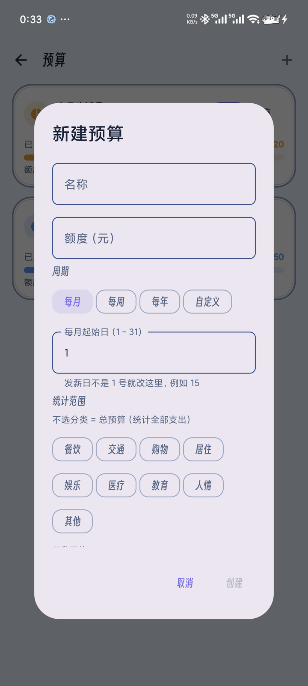
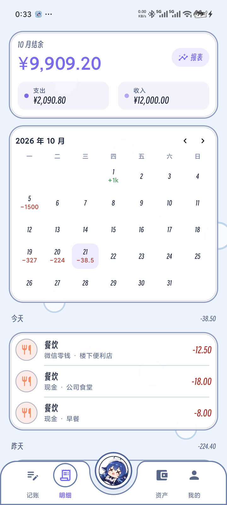
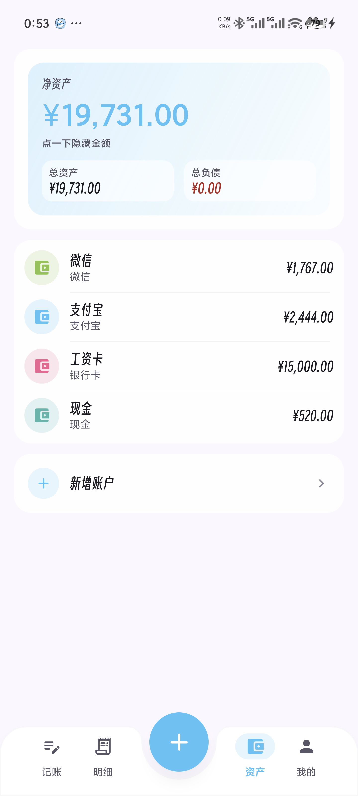
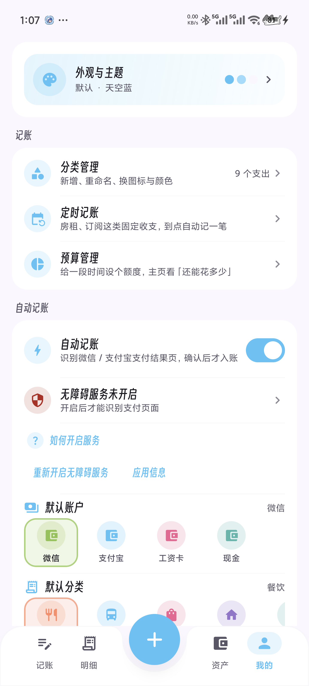
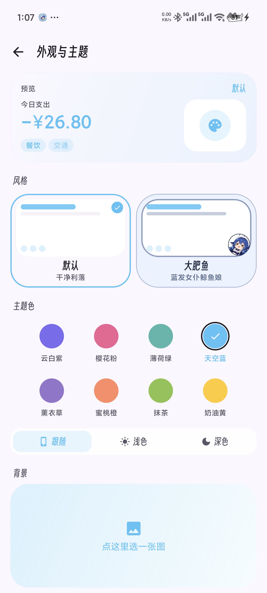

# 阿福记账 (Afu Ledger)

**本地优先、不联网、圆润可换肤**的 Android 记账应用。支持微信 / 支付宝账单自动识别、定时记账、预算预警与收支报表。

<p>
  
  
  
  
</p>

- **完全离线**：不申请 `INTERNET` 权限，所有数据存在本机 Room 数据库
- **数据握在自己手里**：一键导出 JSON 备份，换机 / 重装可完整还原
- **两种自动记账**：无障碍节点 + 截图 OCR，识别微信 / 支付宝的账单详情页
- **预算是第一等的功能**：主页直接看到「还能花多少」，接近上限自动变色提醒

## 目录

- [功能](#功能)
- [截图](#截图)
- [数据与备份](#数据与备份)
- [技术栈](#技术栈)
- [架构](#架构)
- [构建与测试](#构建与测试)
- [自动记账是怎么做的](#自动记账是怎么做的)
- [性能](#性能)
- [已知边界](#已知边界)
- [路线图](#路线图)
- [许可证](#许可证)

## 功能

### 记账

- 手动记账：支出 / 收入、分类、账户、备注、日期；**底部记账面板自带数字键盘**（不弹系统键盘），分类与账户是等宽圆形图标格，点「记账」一步保存
- 明细页：月度结余、可切换月份的月历（点日期筛选）、按日分组的历史
- 分类管理：内置 14 个预置分类，支持新增 / 重命名 / 换图标 / 换颜色 / 删除（被引用的分类禁止删除）
- 32 个可选分类图标，统一圆润风格，每个分类带自己的柔和底色

### 自动记账（微信 / 支付宝）

- 识别**账单详情页**（点进去的那一页），提取金额、商户、交易单号，弹出确认卡片并标明来源
- 微信页面是自绘的、不暴露无障碍节点 → 额外走**截图 + 本机离线 OCR**
- 交易单号做指纹去重：同一笔账单忽略一次后 7 天内不再打扰（重启也记得）
- 同一笔付款跨两个页面（聚合收款 → 支付成功）只记一次
- **只需要无障碍授权**，不申请网络、悬浮窗、通知读取、相册或短信权限；截图只存在内存里，识别完立即丢弃
- 可选 Shizuku 自动恢复被系统移除的无障碍授权（见 [保活说明](#后台存活能管什么管不了什么)）

### 定时记账

- 房租、话费、订阅这类固定收支设一次即可，到点**自动入账**（单条也可改成「先提醒我确认」）
- 支持每天 / 每周指定星期 / 每月指定日（小月收敛到月末）/ 每年 / 每 N 个周期，可设结束日期或总期数
- 错过期次（关机、省电限制）会按计划时刻**补记**并标注，同一期次不会重复入账

### 预算

- **总预算**（不绑分类，统计全部支出）与**分类预算**（绑定 1~N 个分类）
- 周期支持：每月（**起始日可调**，发薪日不是 1 号也能对齐）、每周、每年、自定义起止区间
- 首页预算卡片直接显示「还能花多少」+ 进度条，按使用率分档：
  - `< 60%` 正常 · `60–80%` 提示 · `≥ 阈值（默认 80%）` 橙色预警 · `≥ 100%` 红色超支
- 跨周期自动切换，不用手动「开新的一期」
- 预算不参与结转（本期没花完不会滚到下期），额度只做当期约束

### 资产与报表

- 资产账户：现金 / 银行卡 / 微信 / 支付宝 / 信用卡，余额 = 初始余额 + 收入 − 支出（实时计算，不冗余存储）
- 净资产与总资产超过一万时自动缩写为「万 / 亿 / 万亿」，点一下看完整金额
- 收支报表：月度结余与上月对照、每日支出趋势折线、分类占比环图与排行、单笔支出排行；图表全部 Canvas 手绘，切月份即时重算

### 外观

- 两套完整主题风格（不是只换颜色）：「默认」干净利落，「大肥鱼」是蓝白女仆鲸鱼娘主题——描边贴纸卡片、虚线分隔、气泡装饰、贴纸圆章式底部导航、吉祥物中央按钮
- 8 套主题色，与风格正交，选择后即时生效并持久化
- 深色模式（跟随系统 / 浅色 / 深色），卡片不透明度与背景压暗自动适配
- 自定义背景图：相册选择、可见度滑块、模糊 / 暗色遮罩；**冷启动首帧就有背景**（极小的占位缩略图 + 原图淡入，不再「先白一下」）
- 转场动效：标签切换带方向与纵深、二级页面整屏滑入、记账面板上滑 + 拖拽关闭；系统关闭动画时自动退化
- 标题字体：得意黑 Smiley Sans（SIL OFL 1.1，随包附带许可）

## 截图

| 首页（含预算卡片） | 预算管理 | 新建预算 |
|---|---|---|
|  |  |  |

| 记账面板 | 明细（月历 + 分组） | 收支报表 |
|---|---|---|
|  |  |  |

| 资产 | 定时记账 | 设置 |
|---|---|---|
|  |  |  |

| 外观与主题 |
|---|
|  |

## 数据与备份

记账数据最怕两件事：**升级把数据搞丢**、**换手机搬不过去**。这个项目对两者都有明确处理。

### 升级不会丢数据

- 数据库用 Room，每次 schema 变更都提供 `AutoMigration`，并有 **instrumentation 迁移测试**覆盖「上一版本 → 当前版本」
- 仓库提交了每个版本的 schema JSON（`app/schemas/`），迁移写错会在测试阶段暴露，而不是等用户升级后打不开
- release 包使用**固定 keystore 签名**（`keystore.properties` 配置，密钥不入库），因此系统更新与 `adb install -r` 都是**覆盖安装**，不会触发卸载
- 绝不使用 `fallbackToDestructiveMigration`：迁移失败宁可报错，也不静默清空账本

### 导出 / 导入

- 设置 → 数据管理 → **导出备份**：生成一个 UTF-8 JSON 文件，保存到用户通过系统文件选择器指定的位置（不需要存储权限）
- 备份包含：账户、分类、交易、定时规则、预算，以及格式版本与应用版本
- 导入会先校验格式与版本，再**在一个事务里**「清空 + 写入」，失败整体回滚，不会留下半套数据
- 导出按 500 行分批流式写入，堆内存不随账单数量增长
- 备份文件格式见 `BackupModels.kt`；v1（无预算）备份仍可导入

### 清空数据

设置 → 数据管理 → 清空全部数据（二次确认）。只清账本数据，主题与自动记账开关保留。

## 技术栈

| 维度 | 选择 |
|---|---|
| 语言 | Kotlin 2.3 |
| UI | Jetpack Compose + Material 3 |
| 架构 | MVVM：Screen → ViewModel → Repository → Room DAO |
| 数据库 | Room + KSP（版本化迁移 + schema 导出） |
| 配置存储 | DataStore Preferences |
| 图片加载 | Coil 3（按屏幕尺寸解码背景图） |
| 离线 OCR | ML Kit 中文文字识别（bundled，整页一次推理） |
| 序列化 | kotlinx.serialization（备份文件） |
| 构建 | AGP 9.4 / Gradle 9.8 / compileSdk 37 / minSdk 26 |

## 架构

```
com.afu.ledger
├── auto/                无障碍自动记账（服务、页面规则、金额解析、去重、悬浮窗、OCR）
├── data/
│   ├── local/           Room Entity / DAO / Database（v3：含 budgets）
│   ├── repository/      聚合 DAO，向 UI 暴露 Flow
│   ├── backup/          备份 DTO、导出 / 导入 / 清空
│   ├── prefs/           DataStore（主题、深色模式、背景图与占位缩略图）
│   └── AppContainer.kt  手写依赖容器
├── domain/
│   ├── model/           纯 Kotlin 领域模型（Money、Account、Category、Transaction、Budget）
│   ├── budget/          预算周期计算与预警分档
│   └── schedule/        定时记账的期次计算
├── schedule/            闹钟、开机的恢复、补记
├── ui/
│   ├── theme/           颜色、形状、字体、间距 token、两套风格
│   ├── component/       通用组件（卡片、胶囊按钮、金额文本、预算卡片）
│   ├── home/            首页（今日 + 预算）
│   ├── record/          记账面板
│   ├── history/         明细与月历
│   ├── report/          收支报表
│   ├── assets/          资产账户
│   ├── budget/          预算管理
│   ├── schedule/        定时记账
│   ├── category/        分类管理
│   └── settings/        设置（含数据管理）
└── util/                金额与日期格式化
```

约定：一个文件一个主要类型，单文件不超过 300 行，UI 不直接访问 DAO，金额一律用「分」存 `Long`。

## 构建与测试

需要 JDK 17+、Android SDK（platform 37、build-tools 37）。

```bash
export ANDROID_HOME=/path/to/Android/Sdk
export GRADLE_USER_HOME=/path/to/gradle-home   # 避免污染系统盘

./gradlew assembleDebug
adb install -r app/build/outputs/apk/debug/app-debug.apk
```

### 发布签名

release 包默认回退 debug 签名（方便直接构建），但**正式发布必须配置固定 keystore**，否则下次升级会安装失败：

```bash
cp keystore.properties.example keystore.properties   # 填入自己的 keystore 路径与密码
./gradlew assembleRelease
```

`keystore.properties` 与 `*.jks` 已被 `.gitignore` 排除，**不要提交**。

### 测试

```bash
./gradlew test                        # JVM 单元测试（金额解析、预算周期、日期分组、主题）
./gradlew connectedDebugAndroidTest   # 真机测试（Room 余额聚合、数据库迁移、备份往返）
```

迁移测试需要真机 / 模拟器，会读取 `app/schemas/` 下已导出的 schema。

## 自动记账是怎么做的

### 两条文本来源

| 来源 | 何时使用 | 实测耗时 |
|---|---|---|
| 无障碍节点文本 | 页面节点**丰富**（行数与字符数都达标） | 几十毫秒 |
| 截图 + 离线 OCR | 节点为空或不完整（微信全部页面、支付宝的 H5 账单页） | **283–399ms**（30 行真实账单页） |

- **节点优先，OCR 兜底**：节点文本被判为「丰富」时先采信；识别未命中且 OCR 可用时仍会再试一次，因为有些页面只暴露「返回」这类导航节点
- **整页一次推理**：不做「先检测文本框、再逐行识别」的两阶段。实测两阶段成本与「所有行宽度之和」成正比（30 行要 1 次检测 + 30 次识别，1450–2204ms），整页一次推理只要 283–399ms
- **金额只排除、不挑选**：余额（`¥217.01`）、状态栏网速（`5.24`）会被上下文规则排除；若仍有多个不同金额，直接放弃识别 —— 宁可漏记也不记错
- **主界面不触发**：「扫一扫 / 收付款 / 卡包」这类入口出现就不识别，避免把首页通知当成新支付
- **账单页要有强证据**：命中「交易单号 / 商户单号 / 收单机构」这类字段 ≥ 2，或标题是「账单详情」；只出现「交易 / 订单 / 金额」这类通用词的页面不算
- **OCR 纠错只做数字上下文**：`O→0`、`l→1`、`S→5`、`B→8`、紧邻数字的 `Y→¥`；纠正后仍不合规（如 `¥4Z.5O`）就整次放弃，不猜

### 去重

- 交易单号做指纹；没有单号时退化为「包名 + 金额 + 商户 + 日期」
- 同一张账单忽略一次后 7 天内（含重启）不再弹
- 卡片在切走应用、翻页、点「忽略」或 60 秒超时时自动收起 —— 一张收不掉的卡片会把后续识别全部节流掉

### 截图 OCR 的节流

- 只在微信前台、且无障碍文本读不到东西时才截图
- 页面稳定判定：用户主动点击 / 切页后 180ms，其余内容变化 600ms
- 内容变化至少隔 8 秒截一次，用户点击 / 切页至少隔 1.5 秒
- 连续识别不到会自动退避（最多 60 秒），但用户主动点击时仍按切页间隔放行

> 为什么点击也算切页：微信在同一个 Activity 内翻页（聊天 → 账单列表 → 账单详情）只发内容变化事件、不发窗口状态变化事件。不把点击当换页，用户翻得比 8 秒快就会被节流拦掉、直接漏记。

### 后台存活：能管什么，管不了什么

**无障碍权限本身不会过期。** 它消失的唯一原因是应用被 **force-stop**（AOSP 的 `AccessibilityManagerService.onPackagesForceStoppedLocked` 会把无障碍权限一并移除）。而在这类 ROM 上，从最近任务把卡片划掉就等于 force-stop。

降低影响的做法：

- 前台服务 + 低优先级常驻通知，把进程优先级抬出 cached 区间
- 不阻塞服务连接：悬浮窗预热挪到 `Handler.post`，避免系统 `wait for adding window timeout` 触发后放弃绑定
- 电池优化豁免：设置页「允许后台运行」一键申请
- 失效可被发现：进程存活时用 `AccessibilityManager` 实时监听，被撤销就发告警通知
- 可选 Shizuku 自动恢复：装了 Shizuku 并授权后，每 15 分钟巡检并静默写回启用列表

**做不到的部分**（平台行为，不是实现问题）：

- 被 force-stop 之后，任何纯应用层手段都拿不回权限，必须重新授权
- 由此推出：**别从最近任务里划掉它**

### 不花钱验证

debug 构建内置了模拟页面：

```bash
adb shell am start -n com.afu.ledger/com.afu.ledger.debug.DemoPaymentActivity \
  --es scenario WECHAT_SUCCESS   # 还有 ALIPAY_BILL / AMBIGUOUS / FUTURE / REFUND / NON_PAYMENT
```

`WECHAT_OCR_FULL` / `OCR_NOISE_O` / `OCR_NOISE_BAD` / `OCR_LOW_CONTRAST` / `OCR_CHAT` 用 Canvas 自绘、不产生无障碍节点，专门验证截图 OCR 通道。

## 性能

release 构建实测（Android 16 真机，1440×3200）：

| 场景 | 结果 |
|---|---|
| 冷启动到首帧（`am start -W` TotalTime） | 205–334ms |
| 明细页快速滑动（300 笔 + 照片背景） | Janky 0%，50 分位 11ms / 90 分位 15ms / 99 分位 28ms |
| 设置页快速滑动 | Janky 0%，90 分位 9ms |
| 手势返回 / 标签切换 | 单一 `AfuMotion` 曲线，系统关闭动画时瞬时切换 |
| release APK | 约 19 MB（含 ML Kit 中文 OCR 模型） |

几条性能约定：

- 背景图按**屏幕像素**解码（不按原始分辨率），首帧用 240px 占位缩略图 + 原图淡入
- 设置页的定时刷新订阅放在 `LazyColumn` 之外，避免每次 tick 让所有可见 item 失效
- 交互动效统一由 `AfuMotion` 管理，避免多层动画叠加

## 已知边界

- 自动记账只处理**支出**；银行工资到账、红包到账、退款、先用后付都不在范围内
- 只适配微信与支付宝的**账单详情页 / 支付结果页**；在美团、饿了么、淘宝这类 App 内付款不会触发（它们在自己的 App 里完成支付，账单不在微信 / 支付宝里）
- 页面同时出现两个不同金额时直接放弃识别
- 只保留 arm64-v8a ABI（OCR 运行时的体积考虑）
- 预算不做结转、不做账户维度限制
- 应用不上架任何商店，只通过 GitHub Release 分发 APK

## 路线图

- [x] 手动记账 + 资产 + 换肤
- [x] 无障碍自动记账（微信 / 支付宝）
- [x] 截图 OCR 记账（补上微信自绘页面）
- [x] 定时 / 周期记账
- [x] 收支报表与日历
- [x] 预算管理（总预算 / 分类预算 / 自定义周期 / 预警）
- [x] 本地备份导出与导入、数据库迁移测试
- [ ] 通知监听通道（银行到账、红包、先用后付）
- [ ] 多币种

## 许可证

本项目采用 **[PolyForm Noncommercial 1.0.0](LICENSE)**：

- ✅ 可以：个人学习、研究、自用、修改、再分发（须保留许可与版权声明）
- ❌ 不可以：任何商业用途（含在公司 / 经营场景中使用）
- 版权归作者所有；作者本人不受该许可限制，保留自行商用与另行授权的权利

需要商用授权请开 issue 联系。

第三方组件许可见 [THIRD-PARTY-NOTICES.md](THIRD-PARTY-NOTICES.md)。
